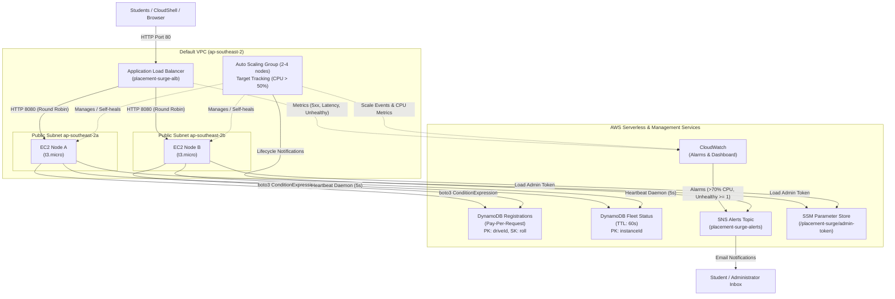

# Placement Surge Portal – System Architecture

## 1. High-Level Architecture Overview

The Placement Surge Portal is an enterprise-grade cloud system built specifically to withstand flash-crowd registration surges (~3,000 concurrent students per minute) within AWS Free Tier guardrails.

---

## 2. Component Taxonomy & Justification

| Component | Cloud Model | Free-Tier Service | Justification vs. Single Fixed Server |
| :--- | :--- | :--- | :--- |
| **Application Load Balancer** | PaaS / Managed | AWS Application Load Balancer | Distributes surge traffic seamlessly across multiple availability zones and isolates instance IPs from the public internet. |
| **Auto Scaling Group** | IaaS Orchestration | EC2 Auto Scaling (t3.micro) | Elastic capacity that automatically expands from 2 to 4 nodes under spike load and self-heals by replacing unhealthy targets without downtime. |
| **EC2 Compute Fleet** | IaaS | Amazon Linux 2023 (t3.micro) | Stateless compute running Gunicorn (2 workers, 4 threads); instances can terminate or boot without state loss. |
| **Registrations Store** | Managed DB / PaaS | Amazon DynamoDB (Pay-Per-Request) | Eliminates database connection limits (max connections pool exhaustion) and provides atomic duplicate elimination via ConditionExpressions. |
| **Fleet State & Heartbeats** | Managed DB / PaaS | Amazon DynamoDB with TTL | Ephemeral node coordination with zero cleanup maintenance; stale nodes expire automatically via DynamoDB TTL. |
| **Alarms & Dashboard** | Managed Observability | Amazon CloudWatch | Real-time visibility into CPU, p95 target latency, and unhealthy host metrics without running custom metric collection servers. |
| **Notification Pipeline** | Managed Messaging | Amazon SNS | Decoupled push delivery of lifecycle events and system alarms directly to email without requiring SMTP servers. |
| **Credential Storage** | Managed Secrets / PaaS | AWS Systems Manager (SSM) Parameter Store | Eliminates hardcoded tokens in Git and user-data scripts; allows constant-time verification of control room operations. |

---

## 3. Security Architecture & Controls

1. **Strict Security Groups & Zero Open SSH**:
   - Port 22 is completely closed everywhere. No SSH keys are provisioned.
   - Shell access is maintained exclusively through AWS Systems Manager Session Manager (`AmazonSSMManagedInstanceCore`).
   - The application security group (`placement-surge-app-sg`) only allows inbound TCP on port 8080 directly from the ALB security group (`placement-surge-alb-sg`). Public traffic cannot reach instances directly.

2. **Least-Privilege IAM Policies**:
   - The instance role contains only `AmazonSSMManagedInstanceCore`, targeted DynamoDB permissions (`PutItem`, `GetItem`, `Query`, `UpdateItem`, `Scan` on the two project tables), and `ssm:GetParameter` for the specific admin token parameter.

3. **IMDSv2 Enforcement**:
   - Launch Template enforces `HttpTokens: required` to prevent SSRF vulnerabilities from accessing EC2 instance metadata credentials.

4. **Web Application Security**:
   - **Content Security Policy (CSP)**: `default-src 'self'; font-src 'self' https://fonts.gstatic.com; style-src 'self' https://fonts.googleapis.com; frame-ancestors 'none'`.
   - **Clickjacking & MIME Protection**: `X-Frame-Options: DENY`, `X-Content-Type-Options: nosniff`, and `Referrer-Policy: strict-origin-when-cross-origin`.
   - **Input Validation**: Server-side regex and numerical validation on every field (name, roll, email, branch, cgpa, resumeUrl).
   - **Payload Limits**: Strict 4 KB request body cap (`MAX_CONTENT_LENGTH = 4096`).
   - **In-Memory Rate Limiting**: 10 requests per minute per IP using the first hop of `X-Forwarded-For`.
   - **PII Privacy**: Personally Identifiable Information (PII) is never written to application logs; only receipt IDs, drive IDs, and node IDs are logged.
   - **Constant-Time Verification**: Admin operations (`/api/ops/fail-health`, `/api/ops/recover`) compare tokens using `hmac.compare_digest` to eliminate timing attacks.
